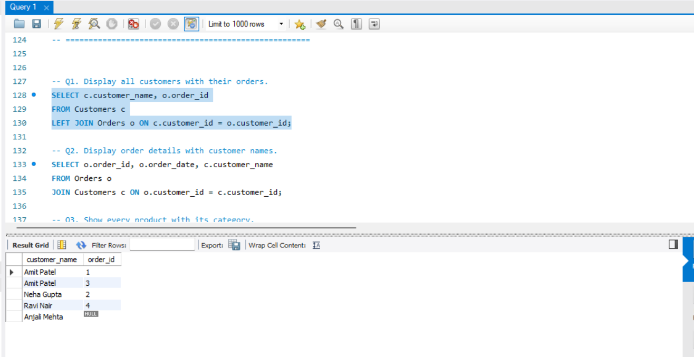
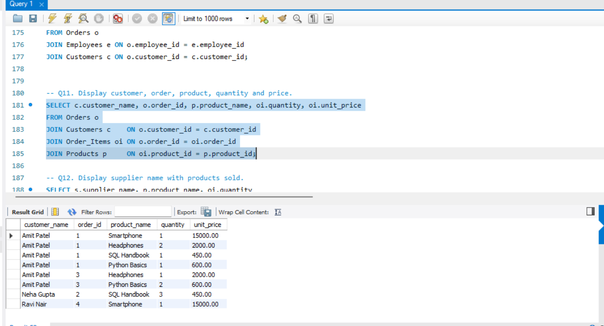
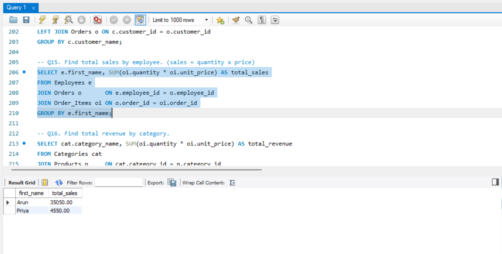
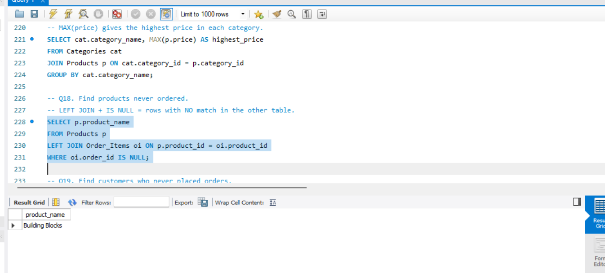
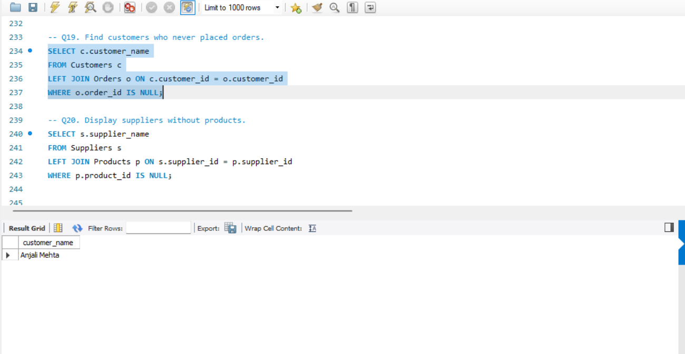
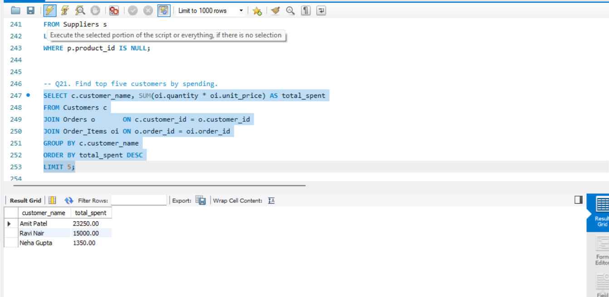
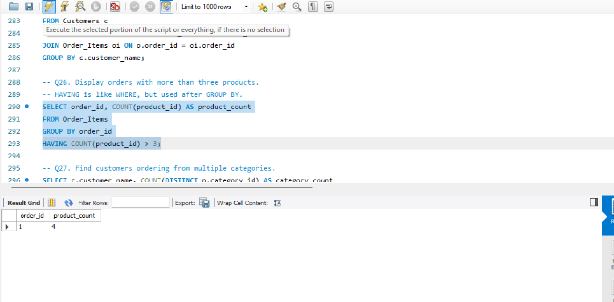
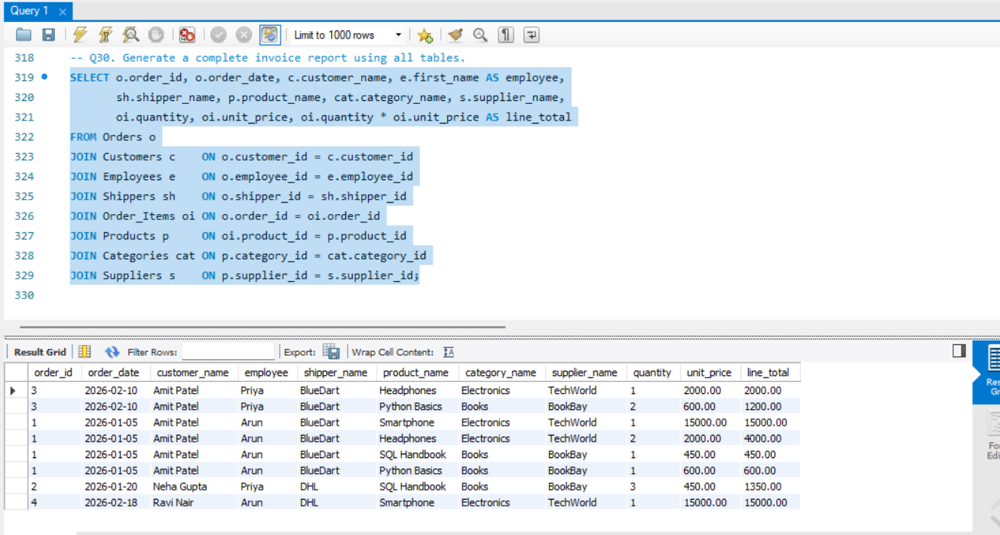

# E-Commerce Database: SQL JOINS Assignment

A MySQL assignment that designs an e-commerce database (`ecommerce_db`) and solves 30 SQL JOIN problems, from beginner to advanced.

## Database tables

| Table | Description |
|---|---|
| Customers | People who buy products |
| Orders | One row per order (links customer, employee, shipper) |
| Order_Items | Products inside each order (quantity, unit price) |
| Products | Items for sale (links category, supplier) |
| Categories | Product groups |
| Suppliers | Companies that supply products |
| Employees | Staff who handle orders |
| Shippers | Delivery companies |

## Files

| File | Purpose |
|---|---|
| `01_create_database_and_tables.sql` | Creates the database and all 8 tables with primary and foreign keys |
| `02_insert_data.sql` | Inserts a small sample dataset (4 customers, 5 products, 4 orders) |
| `03_join_queries.sql` | Solutions to all 30 questions |

## How to run (MySQL Workbench)

1. Open and run `01_create_database_and_tables.sql` (click the lightning bolt).
2. Open and run `02_insert_data.sql`.
3. Open `03_join_queries.sql`, click inside one query and press `Ctrl + Enter` to run it.

## Topics covered

- INNER JOIN, LEFT JOIN
- Joining 3 to 8 tables
- GROUP BY, HAVING, aggregate functions (COUNT, SUM, MAX)
- Finding unmatched rows with `LEFT JOIN ... IS NULL`
- ORDER BY, LIMIT, MONTH()

## Screenshots

### Q1. Display all customers with their orders

### Q11. Display customer, order, product, quantity and price

### Q15. Find total sales by employee

### Q18. Find products never ordered

### Q19. Find customers who never placed orders

### Q21. Find top five customers by spending

### Q26. Display orders with more than three products

### Q30. Generate a complete invoice report using all tables
